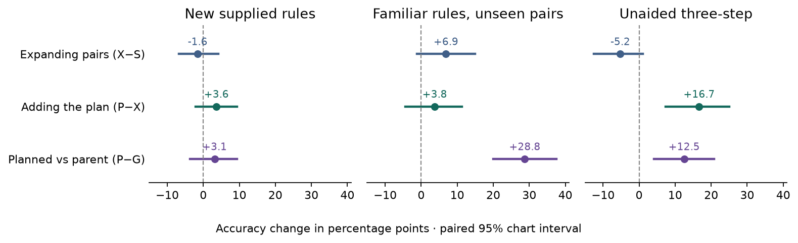

# Phase 9 · Can a 4B model carry the right rule through a complete question?

The highest fresh reference-assisted primary score belonged to **P**. Crossing source rules with more downstream operations changed accuracy by **-1.6 percentage points** relative to the sparse training control (paired 95% chart interval [-6.8, +4.2]). Adding an explicit plan on the identical crossed questions changed accuracy by **+3.6 points** ([-2.1, +9.4]). The predeclared X-versus-S screen **did not pass**.

P is the leading research checkpoint for unaided combinations of familiar rules. It improved from G’s 56/160 to 102/160 on the four held-out familiar-source pairs, a gain of 28.8 points (paired chart interval +20.0 to +37.5). On the primary test with newly supplied rules, P solved only 43/192 (22.4%), compared with G’s 37/192 (19.3%). That six-answer difference remains uncertain. The evidence supports a narrower gain in applying familiar rules across combinations. [P adapter and configuration](../artifacts/adapters/bazireason-phase9-p)

## What Phase 8 established

On familiar wording, all 54 wrong G replies named the correct first branch and returned a wrong value from the requested answer class. Under new wording G missed 89 questions. In 57 of those replies the first written branch was recognizably correct, in 15 it was wrong, and in 17 the extraction rule could not classify it. Only five final values exactly matched the result of another tested operation on the correct branch. A’s isolated practice raised single-step accuracy to 73/80, yet on 52 of those 80 charts A answered the isolated question correctly and the complete one incorrectly. These observations support several failure modes, including selecting an operation, binding it to the right input, performing the lookup, and honoring the output contract. [Independent archive diagnosis and methods review](phase9_diagnosis.md)

G’s original worked graph questions associated different first rules with different sets of allowable next steps. Ten-God examples occurred under two star rules, reaching only eight branches. This made broader training coverage a testable alternative to explicit planning. Controlled studies have found that example diversity can improve compositional generalization and that supervision of intermediate calculations can help algorithmic tasks. Those results motivated the comparisons without supplying an expected BaZi effect size. [Zhou, Jiang & Bansal](https://aclanthology.org/2023.emnlp-main.898/) · [Nye et al.](https://arxiv.org/abs/2112.00114)

## Controlled training

G is the Phase 7 conventional worked-answer adapter. A is Phase 8’s isolated-practice model. S, X and P each continued directly from G with seed 910217. All three used the same 3,036 replay examples and 2,016 new worked questions on 504 charts. Two questions shared a chart and branch but requested different operations, and each chart supplied two different source branches. Every arm saw varied instruction wording, a common answer schema and complete downstream arithmetic or table work.

S retained the original 22 source–operation combinations. X expanded to 51 through operation swaps within matched day-stem and derived-branch cells. Its source and operation marginals and its operation-by-day-stem-by-branch counts matched S exactly. In the new questions, knowing the source yielded 1.354 bits of information about the requested operation for S and 0.143 bits for X. P received X’s exact questions, labels and calculations with an explicit plan and operand bindings in its worked targets. The X−S contrast tests the distribution of training combinations. P−X tests the response format and supervision, including its modest token cost.

| Arm | Rows | Updates | Sequence tokens | Supervised tokens | Padded tokens (planned) | Minutes | Peak GB | Final loss |
| --- | --- | --- | --- | --- | --- | --- | --- | --- |
| S | 5052 | 1263 | 1,589,249 | 866,987 | 1,688,508 | 48.4 | 19.57 | 0.0001 |
| X | 5052 | 1263 | 1,589,307 | 867,031 | 1,680,124 | 47.4 | 19.57 | 0.0001 |
| P | 5052 | 1263 | 1,597,459 | 875,183 | 1,683,644 | 47.5 | 19.57 | 0.0001 |

All arms used the fixed final checkpoint. The equalized operand exposure preserved a limitation across arms. Ten-God targets covered only eight derived branches. Four formerly evaluated edges were deliberately excluded from every arm. Exposure differences on the other 29 added edges are part of the X/P intervention. Prior published scores on those edges can no longer serve as unseen-edge tests for X or P. [Training manifest](../data/phase9/training_manifest.json) · [Readback audit](../results/phase9/training_audit.json)

## Transfer results

The primary test used a compact table defining four previously untrained source lookups drawn from the 三合 and 三会 branch groups. For each chart the model had to read a named year/day branch, find the requested member of its group, then use that branch for a life stage, Ten God, element or hidden-stem answer. Each of 16 source–operation combinations contributed 12 questions. Two requests used the same chart and source. The unaided bridge panel used four familiar source–operation combinations excluded from all three arms, independently written questions and 160 fresh charts. The three-step panel used only familiar rule primitives and no source table.

| Exact answers | G · parent | A · isolated | S · sparse | X · crossed | P · planned |
| --- | --- | --- | --- | --- | --- |
| Reference-assisted, new wording · primary | 37/192 | 22/192 | 39/192 | 36/192 | 43/192 |
| Reference-assisted, canonical wording | 42/192 | 26/192 | 34/192 | 34/192 | 45/192 |
| Day-dependent operations · primary | 17/96 | 9/96 | 17/96 | 13/96 | 12/96 |
| Other operations · primary | 20/96 | 13/96 | 22/96 | 23/96 | 31/96 |
| Both requests on a chart correct | 3/96 | 2/96 | 9/96 | 4/96 | 6/96 |
| New sources, without the reference | 15/96 | 5/96 | 18/96 | 12/96 | 15/96 |
| Source lookup in isolation | 23/96 | 18/96 | 10/96 | 21/96 | 19/96 |
| Correct branch supplied, downstream only | 65/192 | 121/192 | 96/192 | 98/192 | 100/192 |
| Identify the requested operation, four choices | 60/96 | 56/96 | 62/96 | 56/96 | 57/96 |
| Unaided, three-step questions | 14/96 | 19/96 | 15/96 | 10/96 | 26/96 |
| Unaided bridge, familiar sources | 56/160 | 68/160 | 85/160 | 96/160 | 102/160 |
| Fresh familiar rules | 397/400 | 396/400 | 394/400 | 394/400 | 393/400 |
| Fresh calendar questions | 368/400 | 365/400 | 365/400 | 364/400 | 363/400 |

| Contrast | Primary Δ pp | 95% chart interval | 95% producer + chart interval | Leave-one-producer-out range | Wins / losses on same questions |
| --- | --- | --- | --- | --- | --- |
| X-S | -1.6 | [-6.8, +4.2] | [-11.5, +7.3] | [-4.2, +2.8] | 18 / 21 |
| X-G | -0.5 | [-6.2, +5.2] | [-8.9, +9.9] | [-4.9, +2.1] | 20 / 21 |
| P-X | +3.6 | [-2.1, +9.4] | [-2.6, +10.4] | [+2.1, +4.9] | 27 / 20 |
| P-G | +3.1 | [-3.6, +9.4] | [-5.7, +14.1] | [-1.4, +5.6] | 27 / 21 |
| S-G | +1.0 | [-4.7, +7.3] | [-11.5, +19.3] | [-7.6, +4.9] | 23 / 21 |
| A-G | -7.8 | [-13.5, -2.1] | [-15.1, +0.0] | [-10.4, -5.6] | 13 / 28 |

The primary intervals use 10,000 paired bootstrap draws of complete charts, stratified by producer and requested operation pair. The broader sensitivity interval also resamples producers. With four producers and a single training seed, generalizing these intervals to new rule families or independent retraining would overstate the evidence.

On the unaided familiar-source panel, the sparse continuation alone improved over G by 18.1 points (95% chart interval +9.4 to +26.9). Expanding combinations added 6.9 points to S (−1.3 to +15.0), and adding plans to X added 3.8 (−4.4 to +11.3). All four bridge families improved from G to P. Since all three continuations shared contrastive questions, varied wording, worked calculations and replay, the gain over G cannot be assigned entirely to planning or to any one shared change.

On unaided three-step questions P scored 26/96, compared with X’s 10/96 and G’s 14/96. The secondary P−X contrast was +16.7 points (95% chart interval +7.3 to +25.0). P still answered just 18/71 correctly when deleting either or both source steps changed the answer. This panel tests four paths and several secondary contrasts were examined. It merits independent replication.

## Where answers break down

| Matched-question check | G · parent | A · isolated | S · sparse | X · crossed | P · planned |
| --- | --- | --- | --- | --- | --- |
| With reference, on the exact 96 closed-book questions | 18/96 | 10/96 | 17/96 | 18/96 | 26/96 |
| Complete answer right given both isolated answers right | 5/17 | 1/22 | 4/10 | 5/20 | 10/20 |
| Both isolated answers right and complete answer wrong | 12 | 21 | 6 | 15 | 10 |
| Primary when the natal-branch shortcut gives a wrong answer | 18/121 | 8/121 | 14/121 | 13/121 | 20/121 |
| Three-step when dropping either or both source steps gives a wrong answer | 10/71 | 14/71 | 11/71 | 6/71 | 18/71 |

Using the natal branch directly solved 71/192 primary questions. The shortcut rows above restrict the comparison to cases where correct execution must produce a different final value. The operation-choice probe adds a four-option letter response, a format absent from the graph curriculum. Its score reflects both instruction interpretation and compliance with that format. Conditional rates use each model’s own prerequisite successes, so their denominators vary.

| Primary operation | G · parent | A · isolated | S · sparse | X · crossed | P · planned |
| --- | --- | --- | --- | --- | --- |
| element | 11/48 | 7/48 | 9/48 | 14/48 | 17/48 |
| god | 13/48 | 6/48 | 10/48 | 7/48 | 10/48 |
| hidden | 9/48 | 6/48 | 13/48 | 9/48 | 14/48 |
| stage | 4/48 | 3/48 | 7/48 | 6/48 | 2/48 |

| Unaided bridge edge | G · parent | A · isolated | S · sparse | X · crossed | P · planned |
| --- | --- | --- | --- | --- | --- |
| 害→stage | 8/40 | 14/40 | 26/40 | 24/40 | 18/40 |
| 桃花→element | 22/40 | 22/40 | 29/40 | 32/40 | 37/40 |
| 破→god | 11/40 | 15/40 | 16/40 | 19/40 | 21/40 |
| 驿马→positions | 15/40 | 17/40 | 14/40 | 21/40 | 26/40 |

The new-source lookup is itself a bottleneck. P solved only 19/96 isolated source questions with the printed reference, including 0/24 requests for the peak member of a three-harmony group. In p9-transfer-1-05-producer-branch, P found the correct group 亥卯未 but answered 衰 (a stage) instead of selecting 卯, its middle branch. Removing the reference from the matched 96 primary questions reduced P from 26 to 15 correct. The table helped on balance, even though P often misread the requested position.

Giving P the correct branch raised downstream accuracy to 100/192. Both isolated prerequisites were right for only 20 complete questions, and P answered 10 of those correctly. On p9-transfer-0-01-novel-stage it derived 巳 and then began calculating luck-cycle direction, while its isolated downstream reply correctly returned 绝. Across all 48 primary life-stage questions P got two right and returned another life stage on 34. Both selection and execution remain plausible failure modes. Declared plans do not ensure either.

## Preservation and selection

On the fresh retention panels, U8 scored 396/400 on familiar rules and 363/400 on calendar questions. The selection rule requires primary and unaided bridge point improvements over G, plus rule and calendar losses no larger than 1.5 and 2 points respectively against both G and U8. Paired retention intervals resample whole events within task category.

| Candidate | Primary above G | Bridge above G | Rule Δ vs G / U8 (pp) | Calendar Δ vs G / U8 (pp) | All point criteria |
| --- | --- | --- | --- | --- | --- |
| S | True | True | -0.75 / -0.50 | -0.75 / +0.50 | True |
| X | False | True | -0.75 / -0.50 | -1.00 / +0.25 | False |
| P | True | True | -1.00 / -0.75 | -1.25 / +0.00 | True |

| Calendar behavior | U8 | G · parent | A · isolated | S · sparse | X · crossed | P · planned |
| --- | --- | --- | --- | --- | --- | --- |
| False refusal on answerable | 5/249 | 23/249 | 19/249 | 20/249 | 19/249 | 19/249 |
| Definite chart on nonanswerable | 27/151 | 5/151 | 10/151 | 11/151 | 12/151 | 14/151 |

P met the point retention margins. Relative to G, familiar-rule accuracy fell 1.0 point (paired 95% interval −2.0 to −0.25) and calendar accuracy fell 1.25 points (−3.25 to +0.5). Both intervals extend past the respective allowable loss. P also issued nine more definite answers than G on 151 calendar requests without a determinate chart. Keep G and U8 as reference checkpoints and retain S as the simpler scientific control.

## Recommended next step

Before scaling training, test reference reading on a small fresh panel. Hold each chart, table and requested operation fixed, and compare the original compact table with separately labeled rows and columns, then with the correct source branch supplied. Include counterfactual tables in which a row or column changes and require the answer to change accordingly. Pair each case with a direct lookup and a complete question. This distinguishes trouble finding the referenced cell from trouble applying a correctly selected value inside a chain.

If explicit table layout or a supplied branch rescues complete answers, test a short curriculum that gradually removes that support while using unfamiliar table names and independently authored instructions. If P instead reproduces its familiar-rule gains across a second seed and fresh families, it would justify a larger study of explicit planning. A blinded stronger-model reference on the same inputs would quantify the remaining frontier gap. None of these follow-on experiments has been launched.

## Boundaries and verification

Separate agents authored the training prompts and evaluation wording. Labels were cross-checked using independent arithmetic and table lookups. The input audits covered historical and realized training charts and retention dates, and every saved response was re-scored and matched to its input and adapter hashes. All data are synthetic, the system prompt and output format are shared, and the reference-assisted test includes a rule table. The unaided panels measure different forms of transfer. No frontier model was evaluated, so these results cannot quantify a gap to a frontier system.

Started at 12:37 Pacific on November 22. The final report was rendered at 19:09 Pacific, 6.55 elapsed hours. The three training jobs together used 2.39 hours. All 10,400 planned replies were collected (five adapters × 1,920 questions, plus 800 U8 retention replies).

[Frozen protocol](phase9_protocol.md) · [Transfer results and paired intervals](../results/phase9/transfer_comparison.json) · [Bridge and retention results](../results/phase9/preservation.json) · [Error examples](../results/phase9/error_audit.json) · [Selection checks](../results/phase9/selection.json) · [Raw replies and training records](../results/phase9)
