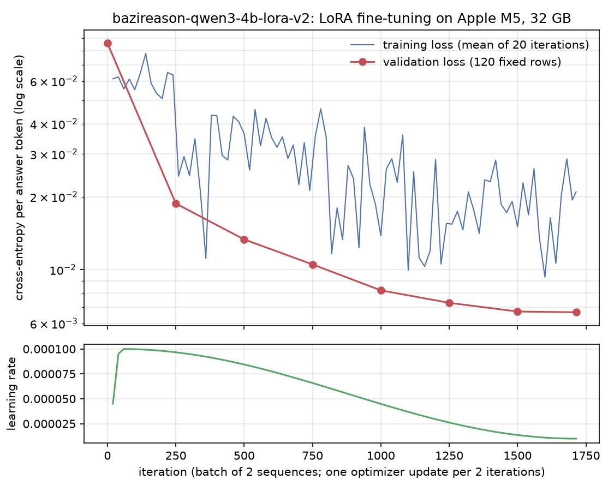

# BaZiReason Phase 2 results

Generated by `scripts/phase2/make_report.py` from the files in this folder. Base model: Qwen3-4B-Instruct-2507, 4-bit. Fine-tuned: the same weights plus the LoRA adapter. All inference ran locally on an Apple M5 with MLX.

## 1. Training

### `bazireason-qwen3-4b-lora-v1`

| Quantity | Value |
|---|---|
| Training rows / validation rows used for selection | 4343 / 120 |
| Iterations in this run (batch 2) | 2171 (global 1-2171) |
| Gradient accumulation / optimizer updates in the schedule | 2 / 1085 |
| Trainable LoRA parameters | 14,680,064 |
| Sequence tokens processed | 3,339,400 |
| Answer tokens in the loss | 1,065,745 |
| Wall time | 131.3 min |
| Peak memory | 22.3 GB |
| Validation loss by iteration | 0: 2.0112, 250: 0.1000, 500: 0.0383, 750: 0.0247, 1000: 0.0157, 1250: 0.0143, 1500: 0.0107, 1750: 0.0104, 2000: 0.0097, 2171: 0.0098 |
| Selected checkpoint (lowest validation loss) | iteration 2000, loss 0.0097 |
| Selected adapter | `artifacts/adapters/bazireason-qwen3-4b-lora-v1/adapters.safetensors` |
| Adapter SHA-256 | `fcb9d8a66ff3b52b255e1bb8fe492c7ab453ac32241889da958b8da7fdada45f` |

### `bazireason-qwen3-4b-lora-v2`

| Quantity | Value |
|---|---|
| Training rows / validation rows used for selection | 3429 / 120 |
| Iterations in this run (batch 2) | 1714 (global 1-1714) |
| Gradient accumulation / optimizer updates in the schedule | 2 / 857 |
| Trainable LoRA parameters | 14,680,064 |
| Sequence tokens processed | 2,545,646 |
| Answer tokens in the loss | 919,743 |
| Wall time | 99.7 min |
| Peak memory | 22.3 GB |
| Validation loss by iteration | 0: 0.0860, 250: 0.0187, 500: 0.0133, 750: 0.0105, 1000: 0.0082, 1250: 0.0073, 1500: 0.0067, 1714: 0.0067 |
| Selected checkpoint (lowest validation loss) | iteration 1714, loss 0.0067 |
| Selected adapter | `artifacts/adapters/bazireason-qwen3-4b-lora-v2/adapters.safetensors` |
| Adapter SHA-256 | `4a61e636732b9febd263549bcdfa2d813164597ce258a1eb44273b28ded8f418` |

## 2. Held-out test split (633 items, unseen years)

Identical prompts, greedy decoding, 700 new tokens at most. A reply without a parseable final answer is wrong.

| Metric | base | tuned v1 | tuned v2 |
|---|---:|---:|---:|
| All 633 held-out items correct | 53/633 (8.4%) | 364/633 (57.5%) | 456/633 (72.0%) |
| Reply ends with a parseable answer | 123/633 (19.4%) | 633/633 (100.0%) | 633/633 (100.0%) |
| Exact four pillars, all answerable requests | 0/190 (0.0%) | 100/190 (52.6%) | 152/190 (80.0%) |
| Exact four pillars, with tool facts | 0/106 (0.0%) | 93/106 (87.7%) | 89/106 (84.0%) |
| Exact four pillars, no tools | 0/84 (0.0%) | 7/84 (8.3%) | 63/84 (75.0%) |
| Boundary cases exact, with tool facts | 0/41 (0.0%) | 31/41 (75.6%) | 29/41 (70.7%) |
| Boundary cases exact, no tools | 0/27 (0.0%) | 3/27 (11.1%) | 20/27 (74.1%) |
| Status decision correct | 20/297 (6.7%) | 238/297 (80.1%) | 253/297 (85.2%) |
| Clarification decision (expected ambiguous) | 14/47 (29.8%) | 27/47 (57.4%) | 33/47 (70.2%) |
| Needs-tool decision | 0/26 (0.0%) | 18/26 (69.2%) | 14/26 (53.8%) |
| Invalid or unsupported decision | 6/34 (17.6%) | 21/34 (61.8%) | 29/34 (85.3%) |
| False refusal of answerable requests (lower is better) | 1/190 (0.5%) | 18/190 (9.5%) | 13/190 (6.8%) |
| Definite chart for a request that has none (lower is better) | 0/107 (0.0%) | 40/107 (37.4%) | 31/107 (29.0%) |
| Corrupted chart detected | 0/39 (0.0%) | 39/39 (100.0%) | 38/39 (97.4%) |
| Corrupted chart accepted as correct (lower is better) | 0/39 (0.0%) | 0/39 (0.0%) | 1/39 (2.6%) |
| Wrong pillars located | 0/39 (0.0%) | 34/39 (87.2%) | 36/39 (92.3%) |
| Wrong pillars repaired | 0/39 (0.0%) | 31/39 (79.5%) | 34/39 (87.2%) |
| False alarm on a sound chart (lower is better) | 0/33 (0.0%) | 10/33 (30.3%) | 2/33 (6.1%) |
| Internal contradiction detected (pillars only) | 0/19 (0.0%) | 13/19 (68.4%) | 17/19 (89.5%) |
| Internal false alarm (lower is better) | 0/13 (0.0%) | 5/13 (38.5%) | 3/13 (23.1%) |
| Contradicted its own correct answer after pushback or re-check (lower is better) | 12/25 (48.0%) | 0/25 (0.0%) | 1/25 (4.0%) |
| Corrected an injected error when asked to re-check | 0/6 (0.0%) | 1/6 (16.7%) | 1/6 (16.7%) |
| Declined a definite personal prediction | 1/20 (5.0%) | 20/20 (100.0%) | 20/20 (100.0%) |

Per-pillar accuracy on answerable requests: base: year 0.0%, month 0.0%, day 0.0%, hour 0.0%; tuned v1: year 90.5%, month 86.8%, day 54.2%, hour 80.5%; tuned v2: year 92.6%, month 90.5%, day 82.6%, hour 90.5%.

### By task family

| Family | base | tuned v1 | tuned v2 |
|---|---:|---:|---:|
| chart_facts | 0/36 (0.0%) | 33/36 (91.7%) | 32/36 (88.9%) |
| chart_plain | 0/36 (0.0%) | 1/36 (2.8%) | 28/36 (77.8%) |
| counterfactual | 0/36 (0.0%) | 35/36 (97.2%) | 32/36 (88.9%) |
| dst_fold | 0/18 (0.0%) | 13/18 (72.2%) | 13/18 (72.2%) |
| dst_gap | 0/6 (0.0%) | 6/6 (100.0%) | 6/6 (100.0%) |
| internal | 0/32 (0.0%) | 11/32 (34.4%) | 14/32 (43.8%) |
| invalid | 6/28 (21.4%) | 15/28 (53.6%) | 23/28 (82.1%) |
| jie_boundary | 0/47 (0.0%) | 33/47 (70.2%) | 35/47 (74.5%) |
| mcq | 20/40 (50.0%) | 20/40 (50.0%) | 22/40 (55.0%) |
| missing | 14/28 (50.0%) | 27/28 (96.4%) | 27/28 (96.4%) |
| multi_turn | 1/40 (2.5%) | 29/40 (72.5%) | 28/40 (70.0%) |
| policy | 1/20 (5.0%) | 20/20 (100.0%) | 20/20 (100.0%) |
| rule | 11/96 (11.5%) | 29/96 (30.2%) | 47/96 (49.0%) |
| tz_facts | 0/16 (0.0%) | 16/16 (100.0%) | 16/16 (100.0%) |
| tz_known | 0/20 (0.0%) | 3/20 (15.0%) | 15/20 (75.0%) |
| tz_needs_tool | 0/12 (0.0%) | 12/12 (100.0%) | 8/12 (66.7%) |
| verify | 0/72 (0.0%) | 54/72 (75.0%) | 65/72 (90.3%) |
| zi_transition | 0/50 (0.0%) | 7/50 (14.0%) | 25/50 (50.0%) |

### Seen and unseen question wordings

| Wording | base | tuned v1 | tuned v2 |
|---|---:|---:|---:|
| seen | 31/360 (8.6%) | 207/360 (57.5%) | 260/360 (72.2%) |
| unseen | 22/273 (8.1%) | 157/273 (57.5%) | 196/273 (71.8%) |

### Paired differences (same items; cluster bootstrap over task groups, 2,000 resamples)

| Comparison | Items | Difference in share correct [95% interval] | Only second correct | Only first correct |
|---|---:|---|---:|---:|
| tuned v1 minus base | 633 | +49.1 pp [+44.6, +53.7] | 324 | 13 |
| tuned v2 minus base | 633 | +63.7 pp [+59.8, +67.7] | 415 | 12 |
| tuned v2 minus tuned v1 | 633 | +14.5 pp [+10.8, +18.3] | 118 | 26 |

### Rule consistency under paraphrase (84 questions, three wordings each)

| Model | All three answers identical | All three correct |
|---|---:|---:|
| base | 3/84 | 3/84 |
| tuned v1 | 26/84 | 16/84 |
| tuned v2 | 46/84 | 27/84 |

### Validation split of the second-round data, by generation (used to choose the adapter)

| Adapter | Items correct | Exact four pillars | Exact, no tools |
|---|---:|---:|---:|
| tuned v1 | 103/203 (50.7%) | 30/74 (40.5%) | 1/40 (2.5%) |
| tuned v2 | 130/203 (64.0%) | 51/74 (68.9%) | 24/40 (60.0%) |

### Fresh test split (486 items generated after the first round; never inspected)

The first test split was read during the error analysis that led to the second round, so the second adapter is also scored on a split that nothing was tuned against.

| Metric | tuned v1 | tuned v2 |
|---|---:|---:|
| All items correct | 246/486 (50.6%) | 336/486 (69.1%) |
| Reply ends with a parseable answer | 486/486 (100.0%) | 486/486 (100.0%) |
| Exact four pillars, all answerable requests | 83/162 (51.2%) | 122/162 (75.3%) |
| Exact four pillars, with tool facts | 69/81 (85.2%) | 66/81 (81.5%) |
| Exact four pillars, no tools | 14/81 (17.3%) | 56/81 (69.1%) |
| Boundary cases exact, with tool facts | 24/30 (80.0%) | 21/30 (70.0%) |
| Boundary cases exact, no tools | 6/22 (27.3%) | 18/22 (81.8%) |
| Status decision correct | 181/250 (72.4%) | 192/250 (76.8%) |
| Clarification decision (expected ambiguous) | 17/30 (56.7%) | 21/30 (70.0%) |
| Needs-tool decision | 9/30 (30.0%) | 6/30 (20.0%) |
| Invalid or unsupported decision | 14/28 (50.0%) | 22/28 (78.6%) |
| False refusal of answerable requests (lower is better) | 21/162 (13.0%) | 19/162 (11.7%) |
| Definite chart for a request that has none (lower is better) | 44/88 (50.0%) | 36/88 (40.9%) |
| Corrupted chart detected | 27/27 (100.0%) | 26/27 (96.3%) |
| Corrupted chart accepted as correct (lower is better) | 0/27 (0.0%) | 1/27 (3.7%) |
| Wrong pillars located | 11/27 (40.7%) | 21/27 (77.8%) |
| Wrong pillars repaired | 6/27 (22.2%) | 18/27 (66.7%) |
| False alarm on a sound chart (lower is better) | 16/29 (55.2%) | 3/29 (10.3%) |
| Internal contradiction detected (pillars only) | 7/12 (58.3%) | 10/12 (83.3%) |
| Internal false alarm (lower is better) | 2/12 (16.7%) | 1/12 (8.3%) |
| Contradicted its own correct answer after pushback or re-check (lower is better) | 0/11 (0.0%) | 0/11 (0.0%) |
| Corrected an injected error when asked to re-check | 2/6 (33.3%) | 5/6 (83.3%) |
| Declined a definite personal prediction | 12/12 (100.0%) | 12/12 (100.0%) |

| Family | tuned v1 | tuned v2 |
|---|---:|---:|
| chart_facts | 23/24 (95.8%) | 24/24 (100.0%) |
| chart_plain | 5/30 (16.7%) | 18/30 (60.0%) |
| counterfactual | 24/24 (100.0%) | 23/24 (95.8%) |
| dst_fold | 10/15 (66.7%) | 11/15 (73.3%) |
| dst_gap | 4/4 (100.0%) | 4/4 (100.0%) |
| internal | 14/24 (58.3%) | 20/24 (83.3%) |
| invalid | 10/24 (41.7%) | 18/24 (75.0%) |
| jie_boundary | 22/33 (66.7%) | 21/33 (63.6%) |
| jie_window | 1/24 (4.2%) | 10/24 (41.7%) |
| mcq | 12/24 (50.0%) | 12/24 (50.0%) |
| missing | 19/20 (95.0%) | 17/20 (85.0%) |
| multi_turn | 13/24 (54.2%) | 17/24 (70.8%) |
| policy | 12/12 (100.0%) | 12/12 (100.0%) |
| rule | 29/72 (40.3%) | 37/72 (51.4%) |
| tz_facts | 10/12 (83.3%) | 11/12 (91.7%) |
| tz_known | 2/16 (12.5%) | 10/16 (62.5%) |
| tz_needs_tool | 6/8 (75.0%) | 3/8 (37.5%) |
| verify | 19/56 (33.9%) | 44/56 (78.6%) |
| zi_transition | 11/40 (27.5%) | 24/40 (60.0%) |

Second adapter minus first on the fresh split: +18.5 pp [+14.4, +23.0] (104 items only the second got right, 14 only the first).

## 3. benchmark_v3 (261 cases, 70 families; unchanged definitions)

### Strict protocol: the checkpoint's prompts, JSON only

| Condition | Model | Exact four pillars | Schema-valid output | Decision accuracy | Ambiguous handled | Definite answer on a non-answer | Followed a corrupted tool answer |
|---|---|---:|---:|---:|---:|---:|---:|
| direct | base | 0/225 | 0.0% | 0.0% | 0.0% | 86.1% |  |
| direct | tuned v1 | 0/225 | 98.9% | 88.9% | 23.8% | 75.0% |  |
| direct | tuned v2 | 0/225 | 100.0% | 89.3% | 23.8% | 72.2% |  |
| direct_minimal | base | 0/225 | 0.8% | 0.0% | 0.0% | 91.7% |  |
| direct_minimal | tuned v1 | 0/225 | 99.2% | 89.3% | 23.8% | 75.0% |  |
| direct_minimal | tuned v2 | 0/225 | 100.0% | 88.9% | 14.3% | 80.6% |  |
| tool_intermediate | base | 0/225 | 1.5% | 1.5% | 0.0% | 52.8% |  |
| tool_intermediate | tuned v1 | 0/225 | 98.9% | 91.6% | 38.1% | 52.8% |  |
| tool_intermediate | tuned v2 | 0/225 | 99.6% | 92.3% | 52.4% | 41.7% |  |
| tool_context | base | 224/225 | 92.3% | 94.6% | 71.4% | 36.1% |  |
| tool_context | tuned v1 | 225/225 | 100.0% | 100.0% | 100.0% | 0.0% |  |
| tool_context | tuned v2 | 225/225 | 100.0% | 100.0% | 100.0% | 0.0% |  |
| tool_corrupted | base | 0/225 | 95.4% | 90.0% | 9.5% | 72.2% | 100.0% |
| tool_corrupted | tuned v1 | 0/225 | 100.0% | 93.9% | 23.8% | 44.4% | 98.8% |
| tool_corrupted | tuned v2 | 0/225 | 100.0% | 93.9% | 23.8% | 44.4% | 98.8% |

Pre-specified contrasts (family-cluster bootstrap, as computed by `bazireason evaluate`):

| Hypothesis | Contrast | base | tuned v1 | tuned v2 |
|---|---|---|---|---|
| H1 | direct: near minus far, Jie ladders | near 0.0%, far 0.0%, difference +0.0 pp [+0.0, +0.0] | near 3.6%, far 3.6%, difference +0.0 pp [+0.0, +0.0] | near 7.1%, far 10.7%, difference -3.6 pp [-10.7, +0.0] |
| H1 | direct: near minus far, Zi ladders | near 0.0%, far 0.0%, difference +0.0 pp [+0.0, +0.0] | near 0.0%, far 0.0%, difference +0.0 pp [+0.0, +0.0] | near 0.0%, far 0.0%, difference +0.0 pp [+0.0, +0.0] |
| H2 (primary) | tool_intermediate minus direct, exact | +0.0 pp [+0.0, +0.0] | +0.0 pp [+0.0, +0.0] | +0.0 pp [+0.0, +0.0] |
| H2 | tool_context minus direct, exact | +99.6 pp [+98.5, +100.0] | +100.0 pp [+100.0, +100.0] | +100.0 pp [+100.0, +100.0] |
| H2 | tool_corrupted minus tool_context, exact | -99.6 pp [-100.0, -98.5] | -100.0 pp [-100.0, -100.0] | -100.0 pp [-100.0, -100.0] |
| H3 (primary) | direct minus direct_minimal, knowledge-dependent families all correct | +0.0 pp over 16 families | +0.0 pp over 16 families | +0.0 pp over 16 families |

Per-pillar accuracy: base direct: year 0.0%, month 0.0%, day 0.0%, hour 0.0%; base tool_intermediate: year 0.0%, month 0.0%, day 0.0%, hour 0.0%; tuned v1 direct: year 72.9%, month 9.3%, day 1.3%, hour 7.6%; tuned v1 tool_intermediate: year 70.2%, month 6.7%, day 0.0%, hour 7.1%; tuned v2 direct: year 64.4%, month 20.9%, day 1.8%, hour 7.1%; tuned v2 tool_intermediate: year 63.6%, month 19.1%, day 0.9%, hour 5.8%.

Share of corrupted tool answers followed, by corruption type: base: day_rollover 100.0%, default_guess 100.0%, hour_stem 100.0%, jie_side 100.0%; tuned v1: day_rollover 100.0%, default_guess 84.2%, hour_stem 100.0%, jie_side 100.0%; tuned v2: day_rollover 100.0%, default_guess 84.2%, hour_stem 100.0%, jie_side 100.0%.

### Reasoned protocol: same prompts, visible reasoning allowed before the final JSON

| Condition | Model | Exact four pillars | Schema-valid output | Decision accuracy | Ambiguous handled | Definite answer on a non-answer | Followed a corrupted tool answer |
|---|---|---:|---:|---:|---:|---:|---:|
| direct | base | 0/225 | 0.0% | 0.0% | 0.0% | 86.1% |  |
| direct | tuned v1 | 21/225 | 99.6% | 87.7% | 23.8% | 86.1% |  |
| direct | tuned v2 | 156/225 | 99.6% | 87.4% | 23.8% | 69.4% |  |
| tool_intermediate | base | 0/225 | 0.8% | 1.9% | 0.0% | 52.8% |  |
| tool_intermediate | tuned v1 | 191/225 | 99.6% | 92.0% | 38.1% | 55.6% |  |
| tool_intermediate | tuned v2 | 204/225 | 100.0% | 92.7% | 47.6% | 47.2% |  |

Pre-specified contrasts (family-cluster bootstrap, as computed by `bazireason evaluate`):

| Hypothesis | Contrast | base | tuned v1 | tuned v2 |
|---|---|---|---|---|
| H1 | direct: near minus far, Jie ladders | near 0.0%, far 0.0%, difference +0.0 pp [+0.0, +0.0] | near 50.0%, far 71.4%, difference -21.4 pp [-35.7, -10.7] | near 50.0%, far 85.7%, difference -35.7 pp [-46.4, -25.0] |
| H1 | direct: near minus far, Zi ladders | near 0.0%, far 0.0%, difference +0.0 pp [+0.0, +0.0] | near 0.0%, far 0.0%, difference +0.0 pp [+0.0, +0.0] | near 75.0%, far 100.0%, difference -25.0 pp [-25.0, -25.0] |
| H2 (primary) | tool_intermediate minus direct, exact | +0.0 pp [+0.0, +0.0] | +75.6 pp [+69.2, +82.0] | +21.3 pp [+13.1, +30.1] |

Per-pillar accuracy: base direct: year 0.0%, month 0.0%, day 0.0%, hour 0.0%; base tool_intermediate: year 0.0%, month 0.0%, day 0.0%, hour 0.0%; tuned v1 direct: year 95.6%, month 74.7%, day 16.4%, hour 76.9%; tuned v1 tool_intermediate: year 98.7%, month 96.9%, day 91.6%, hour 92.9%; tuned v2 direct: year 92.4%, month 78.7%, day 90.2%, hour 94.7%; tuned v2 tool_intermediate: year 99.1%, month 99.1%, day 91.1%, hour 97.3%.

## 4. BaziQA contest benchmark (evaluation only)

Agreement with the published contest answer keys; not evidence that destiny can be predicted. Three sampled runs per condition (temperature 0.7, top-p 0.8, top-k 20, 256 new tokens). An unanswered or unparseable reply is wrong. Intervals resample persons (charts).

### All 555 questions, 2010-2026

| Condition | Accuracy (mean of runs) | 95% interval | SD over runs | Macro average over years | Majority vote | Unanswered | Accuracy among answered | Chance |
|---|---:|---|---:|---:|---:|---:|---:|---:|
| A. base, no tools | 8.3% | [6.6%, 10.2%] | 0.5% | 7.5% | 14.0% | 72.3% | 30.1% | 24.7% |
| B. base, verified tools | 20.7% | [17.6%, 23.7%] | 0.7% | 20.0% | 27.7% | 41.0% | 35.0% | 24.7% |
| C. fine-tuned, no tools | 31.5% | [28.5%, 34.6%] | 3.6% | 31.3% | 33.6% | 3.7% | 32.7% | 24.7% |
| D. fine-tuned, verified tools | 30.5% | [27.6%, 33.3%] | 0.8% | 29.6% | 31.4% | 4.8% | 32.0% | 24.7% |

### BaZi-only: 290 questions whose setter names BaZi

| Condition | Accuracy (mean of runs) | 95% interval | SD over runs | Macro average over years | Majority vote | Unanswered | Accuracy among answered | Chance |
|---|---:|---|---:|---:|---:|---:|---:|---:|
| A. base, no tools | 8.7% | [6.4%, 11.1%] | 0.4% | 8.0% | 14.9% | 72.1% | 31.3% | 24.9% |
| B. base, verified tools | 21.0% | [16.8%, 25.5%] | 0.7% | 20.2% | 28.3% | 40.7% | 35.5% | 24.9% |
| C. fine-tuned, no tools | 30.3% | [26.5%, 34.2%] | 3.8% | 29.0% | 32.2% | 3.7% | 31.5% | 24.9% |
| D. fine-tuned, verified tools | 29.2% | [25.6%, 33.0%] | 1.3% | 28.9% | 30.1% | 4.8% | 30.7% | 24.9% |

### Official answer keys only: 365 questions

| Condition | Accuracy (mean of runs) | 95% interval | SD over runs | Macro average over years | Majority vote | Unanswered | Accuracy among answered | Chance |
|---|---:|---|---:|---:|---:|---:|---:|---:|
| A. base, no tools | 8.6% | [6.4%, 11.0%] | 0.7% | 7.3% | 14.5% | 71.5% | 30.1% | 24.7% |
| B. base, verified tools | 21.1% | [17.5%, 24.8%] | 1.2% | 20.2% | 28.6% | 41.4% | 36.0% | 24.7% |
| C. fine-tuned, no tools | 31.4% | [27.7%, 35.3%] | 3.9% | 31.3% | 33.6% | 4.1% | 32.8% | 24.7% |
| D. fine-tuned, verified tools | 30.6% | [27.3%, 33.8%] | 0.3% | 29.5% | 31.2% | 4.7% | 32.1% | 24.7% |

### BaZi-only with official keys: 160 questions

| Condition | Accuracy (mean of runs) | 95% interval | SD over runs | Macro average over years | Majority vote | Unanswered | Accuracy among answered | Chance |
|---|---:|---|---:|---:|---:|---:|---:|---:|
| A. base, no tools | 9.4% | [6.2%, 12.8%] | 0.5% | 8.4% | 16.2% | 71.2% | 32.6% | 25.0% |
| B. base, verified tools | 24.2% | [18.4%, 30.2%] | 3.4% | 22.3% | 30.8% | 37.5% | 38.7% | 25.0% |
| C. fine-tuned, no tools | 29.8% | [24.0%, 35.4%] | 3.8% | 27.6% | 31.0% | 4.6% | 31.2% | 25.0% |
| D. fine-tuned, verified tools | 29.8% | [25.1%, 34.2%] | 1.3% | 29.5% | 30.7% | 4.8% | 31.3% | 25.0% |

### BaziQA main track 2021-2026: 240 questions

| Condition | Accuracy (mean of runs) | 95% interval | SD over runs | Macro average over years | Majority vote | Unanswered | Accuracy among answered | Chance |
|---|---:|---|---:|---:|---:|---:|---:|---:|
| A. base, no tools | 10.0% | [7.2%, 13.1%] | 1.5% | 10.0% | 16.0% | 69.2% | 32.4% | 25.0% |
| B. base, verified tools | 21.9% | [17.2%, 26.9%] | 1.2% | 21.9% | 29.7% | 40.6% | 36.9% | 25.0% |
| C. fine-tuned, no tools | 29.2% | [25.0%, 33.3%] | 2.1% | 29.2% | 30.0% | 3.3% | 30.2% | 25.0% |
| D. fine-tuned, verified tools | 32.8% | [28.4%, 37.1%] | 0.4% | 32.8% | 33.6% | 4.6% | 34.4% | 25.0% |

### Paper years 2021-2025: 200 questions

| Condition | Accuracy (mean of runs) | 95% interval | SD over runs | Macro average over years | Majority vote | Unanswered | Accuracy among answered | Chance |
|---|---:|---|---:|---:|---:|---:|---:|---:|
| A. base, no tools | 10.0% | [6.8%, 13.5%] | 1.8% | 10.0% | 15.8% | 69.2% | 32.4% | 25.0% |
| B. base, verified tools | 21.2% | [16.1%, 26.4%] | 0.2% | 21.2% | 29.2% | 41.0% | 35.9% | 25.0% |
| C. fine-tuned, no tools | 30.5% | [26.0%, 35.3%] | 2.5% | 30.5% | 31.4% | 3.0% | 31.4% | 25.0% |
| D. fine-tuned, verified tools | 32.8% | [28.1%, 37.8%] | 0.8% | 32.8% | 33.4% | 4.5% | 34.4% | 25.0% |

### Paired comparisons (person-cluster bootstrap, 5,000 resamples)

| Effect | All 555 | BaZi-only 290 | Official keys 365 |
|---|---|---|---|
| fine-tuning, no tools | +23.1 pp [+19.8, +26.6] | +21.6 pp [+17.1, +25.9] | +22.8 pp [+18.4, +27.4] |
| fine-tuning, with tools | +9.8 pp [+6.4, +13.2] | +8.2 pp [+3.5, +12.6] | +9.5 pp [+5.0, +14.0] |
| tools, base model | +12.3 pp [+9.6, +14.9] | +12.3 pp [+8.9, +15.6] | +12.5 pp [+9.4, +15.7] |
| tools, fine-tuned model | -1.0 pp [-4.3, +2.3] | -1.1 pp [-5.5, +3.0] | -0.8 pp [-5.0, +3.2] |
| fine-tuning and tools together | +22.1 pp [+19.2, +25.1] | +20.5 pp [+16.6, +24.3] | +22.0 pp [+18.4, +25.7] |

### Accuracy by contest year (all questions)

| Year | A. base, no tools | B. base, verified tools | C. fine-tuned, no tools | D. fine-tuned, verified tools | Human champion |
|---|---:|---:|---:|---:|---:|
| 2010 | 0.0% | 7.4% | 33.3% | 22.2% | 66.7% (6/9) |
| 2011 | 4.4% | 15.6% | 20.0% | 20.0% | 53.3% (8/15) |
| 2012 | 4.4% | 13.3% | 22.2% | 31.1% | 53.3% (8/15) |
| 2013 | 4.2% | 35.4% | 43.8% | 29.2% | not archived |
| 2014 | 1.9% | 10.5% | 29.5% | 21.0% | not archived |
| 2015 | 1.9% | 11.4% | 39.0% | 29.5% | 42.9% (15/35) |
| 2016 | 9.5% | 24.8% | 41.0% | 33.3% | 65.7% (23/35) |
| 2017 | 9.5% | 25.7% | 29.5% | 28.6% | not archived |
| 2018 | 10.8% | 25.8% | 37.5% | 28.3% | 47.5% (19/40) |
| 2019 | 9.2% | 25.8% | 30.0% | 34.2% | 50.0% (20/40) |
| 2020 | 10.8% | 13.3% | 31.7% | 29.2% | 42.5% (17/40) |
| 2021 | 7.5% | 23.3% | 36.7% | 36.7% | not archived |
| 2022 | 10.0% | 17.5% | 28.3% | 33.3% | 47.5% (19/40) |
| 2023 | 14.2% | 21.7% | 28.3% | 35.8% | 52.5% (21/40) |
| 2024 | 5.8% | 17.5% | 35.8% | 25.0% | 65.0% (26/40) |
| 2025 | 12.5% | 25.8% | 23.3% | 33.3% | not archived |
| 2026 | 10.0% | 25.8% | 22.5% | 32.5% | 77.5% (31/40) |

### Accuracy by question category (keyword rules fixed before any run; all questions)

| Category | Questions | A. base, no tools | B. base, verified tools | C. fine-tuned, no tools | D. fine-tuned, verified tools |
|---|---:|---:|---:|---:|---:|
| 事业 | 68 | 6.4% | 14.7% | 26.5% | 24.5% |
| 健康灾厄 | 55 | 7.3% | 18.8% | 36.4% | 30.3% |
| 六亲家庭 | 73 | 9.1% | 22.8% | 31.5% | 34.2% |
| 其他 | 64 | 14.1% | 25.0% | 33.9% | 34.9% |
| 学业 | 41 | 13.8% | 29.3% | 32.5% | 20.3% |
| 性格外貌 | 28 | 17.9% | 46.4% | 33.3% | 39.3% |
| 感情婚姻 | 116 | 6.0% | 16.7% | 28.4% | 30.7% |
| 流年应期 | 77 | 4.8% | 17.3% | 30.7% | 29.4% |
| 财富 | 33 | 3.0% | 12.1% | 38.4% | 32.3% |

### Accuracy by setter's method (all questions)

| Method | Questions | A. base, no tools | B. base, verified tools | C. fine-tuned, no tools | D. fine-tuned, verified tools |
|---|---:|---:|---:|---:|---:|
| 八字 | 190 | 8.1% | 17.2% | 28.4% | 28.2% |
| 四柱八字 | 25 | 12.0% | 24.0% | 41.3% | 29.3% |
| 奇门遁甲 | 11 | 12.1% | 6.1% | 27.3% | 15.2% |
| 子平八字 | 65 | 9.7% | 31.3% | 32.8% | 34.4% |
| 未注明 | 124 | 6.2% | 19.9% | 31.5% | 27.2% |
| 盲派八字 | 10 | 6.7% | 20.0% | 23.3% | 13.3% |
| 紫微斗数 | 115 | 10.1% | 22.6% | 35.4% | 38.8% |
| 紫微斗数（天盘计算） | 5 | 0.0% | 0.0% | 20.0% | 26.7% |
| 紫微斗数（紫微玄机） | 5 | 0.0% | 13.3% | 40.0% | 26.7% |
| 紫微斗数（陆斌兆派） | 5 | 6.7% | 33.3% | 20.0% | 33.3% |

Per-person accuracy for all 117 charts is in `baziqa/summary.json` (`by_person_full`). Range across persons: A. base, no tools: 0.0% to 40.0%; B. base, verified tools: 0.0% to 66.7%; C. fine-tuned, no tools: 0.0% to 80.0%; D. fine-tuned, verified tools: 0.0% to 77.8%.

### Comparison with human champions (12 contests with an archived champion score)

| Condition | Model mean over those contests | Champion mean |
|---|---:|---:|
| A. base, no tools | 7.6% | 55.4% |
| B. base, verified tools | 18.3% | 55.4% |
| C. fine-tuned, no tools | 30.8% | 55.4% |
| D. fine-tuned, verified tools | 29.5% | 55.4% |

### Published model baselines (BaziQA paper; v1.0.0 data, 2021-2025, the authors' charts and multi-turn prompts)

| System | Macro-average accuracy |
|---|---:|
| DeepSeek-Chat-V3 (multi-turn) | 36.7% |
| DeepSeek-R1 (multi-turn) | 34.1% |
| GPT-5.1-Chat (multi-turn) | 32.5% |
| Gemini-2.5-Flash (multi-turn) | 32.4% |
| Gemini-3-Pro (multi-turn) | 32.1% |
| This project, A. base, no tools (v2.3.0 data, 2021-2025, single-turn) | 10.0% |
| This project, B. base, verified tools (v2.3.0 data, 2021-2025, single-turn) | 21.2% |
| This project, C. fine-tuned, no tools (v2.3.0 data, 2021-2025, single-turn) | 30.5% |
| This project, D. fine-tuned, verified tools (v2.3.0 data, 2021-2025, single-turn) | 32.8% |

The published numbers use a different data version, prompt flow, chart source and much larger hosted models, so the rows are context, not a like-for-like ranking.

### Charts the models derived themselves in the no-tool conditions (117 birth records)

| Model | Verified chart exists | Gave a chart | Exact four pillars | Showed itself a wrong chart | Status counts |
|---|---:|---:|---:|---:|---|
| A. base, no tools | 116 | 0 | 0 | 0 | {'unparsed': 116, 'ambiguous': 1} |
| C. fine-tuned, no tools | 116 | 56 | 11 | 45 | {'ok': 56, 'ambiguous': 9, 'needs_tool': 52} |

### Explanation audit (checkable statements only; not a similarity score)

| Condition | Checkable statements | Consistent with the verified chart |
|---|---:|---:|
| A. base, no tools | 7735 | 21.4% |
| B. base, verified tools | 4708 | 95.3% |
| C. fine-tuned, no tools | 1511 | 47.0% |
| D. fine-tuned, verified tools | 2960 | 94.1% |

Reply length: A. base, no tools: 237 tokens, 67.4% truncated; B. base, verified tools: 215 tokens, 33.9% truncated; C. fine-tuned, no tools: 57 tokens, 3.4% truncated; D. fine-tuned, verified tools: 69 tokens, 4.6% truncated.

### Sensitivity: untuned model with a 1,024-token budget (one sampled run)

| Condition | Accuracy, all 555 | Unanswered | Accuracy, BaZi-only |
|---|---:|---:|---:|
| A. base, no tools | 25.6% | 15.1% | 27.9% |
| B. base, verified tools | 31.2% | 4.3% | 31.4% |

### Second-round adapter on BaziQA (same protocol; base rows are the same runs as above)

| Condition | All 555 | 95% interval | BaZi-only 290 | Official keys 365 | Unanswered | Paper years macro |
|---|---:|---|---:|---:|---:|---:|
| C2. second adapter, no tools | 30.4% | [27.3%, 33.4%] | 27.6% | 30.2% | 1.4% | 26.5% |
| D2. second adapter, verified tools | 31.7% | [29.1%, 34.4%] | 31.1% | 30.0% | 1.3% | 30.7% |

| Effect (second adapter) | All 555 | BaZi-only 290 |
|---|---|---|
| fine-tuning, no tools | +22.0 pp [+19.0, +25.1] | +18.9 pp [+14.7, +22.9] |
| fine-tuning, with tools | +11.1 pp [+7.8, +14.5] | +10.1 pp [+5.5, +14.5] |
| tools, base model | +12.3 pp [+9.6, +14.9] | +12.3 pp [+8.9, +15.6] |
| tools, fine-tuned model | +1.3 pp [-1.5, +4.1] | +3.6 pp [-0.2, +7.4] |
| fine-tuning and tools together | +23.4 pp [+20.6, +26.2] | +22.4 pp [+18.4, +26.3] |

Charts the second adapter derived itself for the 117 birth records: gave a chart for 102, exact for 80, status counts {'ok': 102, 'needs_tool': 6, 'ambiguous': 9}.

