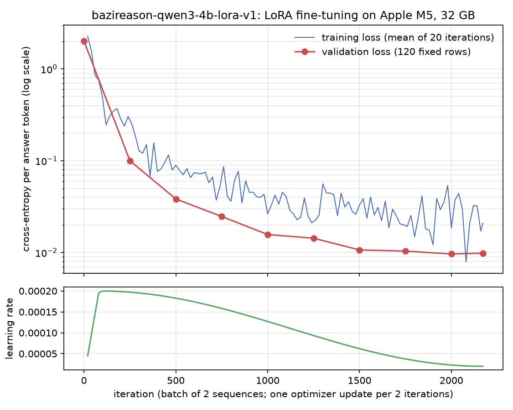

# BaZiReason Phase 2 results

Generated by `scripts/phase2/make_report.py` from the files in this folder. Base model: Qwen3-4B-Instruct-2507, 4-bit. Fine-tuned: the same weights plus the LoRA adapter. All inference ran locally on an Apple M5 with MLX.

## 1. Training

### `bazireason-qwen3-4b-lora-v1`

| Quantity | Value |
|---|---|
| Training rows / validation rows used for selection | 4343 / 120 |
| Iterations in this run (batch 2) | 2171 (global 1-2171) |
| Gradient accumulation / optimizer updates in the schedule | 2 / 1085 |
| Trainable LoRA parameters | 14,680,064 |
| Sequence tokens processed | 3,339,400 |
| Answer tokens in the loss | 1,065,745 |
| Wall time | 131.3 min |
| Peak memory | 22.3 GB |
| Validation loss by iteration | 0: 2.0112, 250: 0.1000, 500: 0.0383, 750: 0.0247, 1000: 0.0157, 1250: 0.0143, 1500: 0.0107, 1750: 0.0104, 2000: 0.0097, 2171: 0.0098 |
| Selected checkpoint (lowest validation loss) | iteration 2000, loss 0.0097 |
| Selected adapter | `artifacts/adapters/bazireason-qwen3-4b-lora-v1/adapters.safetensors` |
| Adapter SHA-256 | `fcb9d8a66ff3b52b255e1bb8fe492c7ab453ac32241889da958b8da7fdada45f` |

- `bazireason-qwen3-4b-lora-v1-e2`: not run or not finished.

## 2. Held-out test split (633 items, unseen years)

Identical prompts, greedy decoding, 700 new tokens at most. A reply without a parseable final answer is wrong.

| Metric | base | tuned v1 |
|---|---:|---:|
| All 633 held-out items correct | 53/633 (8.4%) | 364/633 (57.5%) |
| Reply ends with a parseable answer | 123/633 (19.4%) | 633/633 (100.0%) |
| Exact four pillars, all answerable requests | 0/190 (0.0%) | 100/190 (52.6%) |
| Exact four pillars, with tool facts | 0/106 (0.0%) | 93/106 (87.7%) |
| Exact four pillars, no tools | 0/84 (0.0%) | 7/84 (8.3%) |
| Boundary cases exact, with tool facts | 0/41 (0.0%) | 31/41 (75.6%) |
| Boundary cases exact, no tools | 0/27 (0.0%) | 3/27 (11.1%) |
| Status decision correct | 20/297 (6.7%) | 238/297 (80.1%) |
| Clarification decision (expected ambiguous) | 14/47 (29.8%) | 27/47 (57.4%) |
| Needs-tool decision | 0/26 (0.0%) | 18/26 (69.2%) |
| Invalid or unsupported decision | 6/34 (17.6%) | 21/34 (61.8%) |
| False refusal of answerable requests (lower is better) | 1/190 (0.5%) | 18/190 (9.5%) |
| Definite chart for a request that has none (lower is better) | 0/107 (0.0%) | 40/107 (37.4%) |
| Corrupted chart detected | 0/39 (0.0%) | 39/39 (100.0%) |
| Corrupted chart accepted as correct (lower is better) | 0/39 (0.0%) | 0/39 (0.0%) |
| Wrong pillars located | 0/39 (0.0%) | 34/39 (87.2%) |
| Wrong pillars repaired | 0/39 (0.0%) | 31/39 (79.5%) |
| False alarm on a sound chart (lower is better) | 0/33 (0.0%) | 10/33 (30.3%) |
| Internal contradiction detected (pillars only) | 0/19 (0.0%) | 13/19 (68.4%) |
| Internal false alarm (lower is better) | 0/13 (0.0%) | 5/13 (38.5%) |
| Contradicted its own correct answer after pushback or re-check (lower is better) | 12/25 (48.0%) | 0/25 (0.0%) |
| Corrected an injected error when asked to re-check | 0/6 (0.0%) | 1/6 (16.7%) |
| Declined a definite personal prediction | 1/20 (5.0%) | 20/20 (100.0%) |

Per-pillar accuracy on answerable requests: base: year 0.0%, month 0.0%, day 0.0%, hour 0.0%; tuned v1: year 90.5%, month 86.8%, day 54.2%, hour 80.5%.

### By task family

| Family | base | tuned v1 |
|---|---:|---:|
| chart_facts | 0/36 (0.0%) | 33/36 (91.7%) |
| chart_plain | 0/36 (0.0%) | 1/36 (2.8%) |
| counterfactual | 0/36 (0.0%) | 35/36 (97.2%) |
| dst_fold | 0/18 (0.0%) | 13/18 (72.2%) |
| dst_gap | 0/6 (0.0%) | 6/6 (100.0%) |
| internal | 0/32 (0.0%) | 11/32 (34.4%) |
| invalid | 6/28 (21.4%) | 15/28 (53.6%) |
| jie_boundary | 0/47 (0.0%) | 33/47 (70.2%) |
| mcq | 20/40 (50.0%) | 20/40 (50.0%) |
| missing | 14/28 (50.0%) | 27/28 (96.4%) |
| multi_turn | 1/40 (2.5%) | 29/40 (72.5%) |
| policy | 1/20 (5.0%) | 20/20 (100.0%) |
| rule | 11/96 (11.5%) | 29/96 (30.2%) |
| tz_facts | 0/16 (0.0%) | 16/16 (100.0%) |
| tz_known | 0/20 (0.0%) | 3/20 (15.0%) |
| tz_needs_tool | 0/12 (0.0%) | 12/12 (100.0%) |
| verify | 0/72 (0.0%) | 54/72 (75.0%) |
| zi_transition | 0/50 (0.0%) | 7/50 (14.0%) |

### Seen and unseen question wordings

| Wording | base | tuned v1 |
|---|---:|---:|
| seen | 31/360 (8.6%) | 207/360 (57.5%) |
| unseen | 22/273 (8.1%) | 157/273 (57.5%) |

### Paired differences (same items; cluster bootstrap over task groups, 2,000 resamples)

| Comparison | Items | Difference in share correct [95% interval] | Only second correct | Only first correct |
|---|---:|---|---:|---:|
| tuned v1 minus base | 633 | +49.1 pp [+44.6, +53.7] | 324 | 13 |

### Rule consistency under paraphrase (84 questions, three wordings each)

| Model | All three answers identical | All three correct |
|---|---:|---:|
| base | 3/84 | 3/84 |
| tuned v1 | 26/84 | 16/84 |

## 3. benchmark_v3 (261 cases, 70 families; unchanged definitions)

### Strict protocol: the checkpoint's prompts, JSON only

| Condition | Model | Exact four pillars | Schema-valid output | Decision accuracy | Ambiguous handled | Definite answer on a non-answer | Followed a corrupted tool answer |
|---|---|---:|---:|---:|---:|---:|---:|
| direct | base | 0/225 | 0.0% | 0.0% | 0.0% | 86.1% |  |
| direct | tuned | 0/225 | 98.9% | 88.9% | 23.8% | 75.0% |  |
| direct_minimal | base | 0/225 | 0.8% | 0.0% | 0.0% | 91.7% |  |
| direct_minimal | tuned | 0/225 | 99.2% | 89.3% | 23.8% | 75.0% |  |
| tool_intermediate | base | 0/225 | 1.5% | 1.5% | 0.0% | 52.8% |  |
| tool_intermediate | tuned | 0/225 | 98.9% | 91.6% | 38.1% | 52.8% |  |
| tool_context | base | 224/225 | 92.3% | 94.6% | 71.4% | 36.1% |  |
| tool_context | tuned | 225/225 | 100.0% | 100.0% | 100.0% | 0.0% |  |
| tool_corrupted | base | 0/225 | 95.4% | 90.0% | 9.5% | 72.2% | 100.0% |
| tool_corrupted | tuned | 0/225 | 100.0% | 93.9% | 23.8% | 44.4% | 98.8% |

Pre-specified contrasts (family-cluster bootstrap, as computed by `bazireason evaluate`):

| Hypothesis | Contrast | base | tuned |
|---|---|---|---|
| H1 | direct: near minus far, Jie ladders | near 0.0%, far 0.0%, difference +0.0 pp | near 3.6%, far 3.6%, difference +0.0 pp |
| H1 | direct: near minus far, Zi ladders | near 0.0%, far 0.0%, difference +0.0 pp | near 0.0%, far 0.0%, difference +0.0 pp |
| H2 (primary) | tool_intermediate minus direct, exact | +0.0 pp [+0.0, +0.0] | +0.0 pp [+0.0, +0.0] |
| H2 | tool_context minus direct, exact | +99.6 pp [+98.5, +100.0] | +100.0 pp [+100.0, +100.0] |
| H2 | tool_corrupted minus tool_context, exact | -99.6 pp [-100.0, -98.5] | -100.0 pp [-100.0, -100.0] |
| H3 (primary) | direct minus direct_minimal, knowledge-dependent families all correct | +0.0 pp over 16 families | +0.0 pp over 16 families |

Per-pillar accuracy: base direct: year 0.0%, month 0.0%, day 0.0%, hour 0.0%; base tool_intermediate: year 0.0%, month 0.0%, day 0.0%, hour 0.0%; tuned direct: year 72.9%, month 9.3%, day 1.3%, hour 7.6%; tuned tool_intermediate: year 70.2%, month 6.7%, day 0.0%, hour 7.1%.

### Reasoned protocol: same prompts, visible reasoning allowed before the final JSON

Not run or not finished.

## 4. BaziQA contest benchmark (evaluation only)

Not run or not finished.

