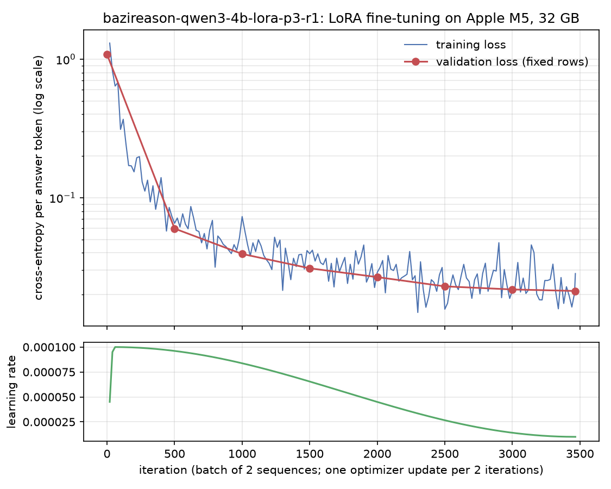
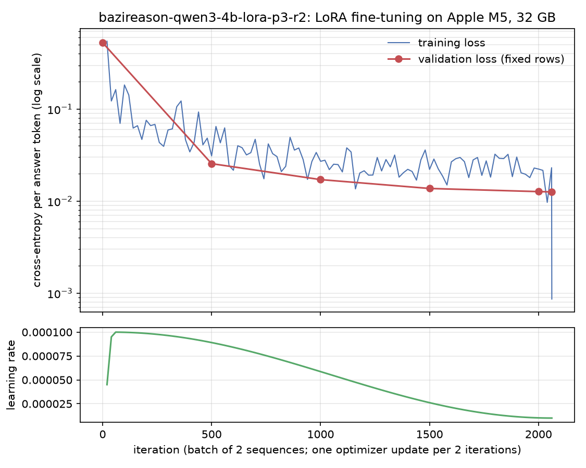

# Phase 3 results

Generated by `scripts/phase3/make_report.py` from the files in this folder. Real local inference and training on an Apple M5 with 32 GB; no mock output.

## 1. Training runs and adapter selection

| Run | Starts from | Rows | Iterations | Optimizer updates | Peak LR | Minutes | Validation loss (start → selected) | Sequence tokens | Peak memory |
|---|---|---:|---:|---:|---:|---:|---|---:|---:|
| `bazireason-qwen3-4b-lora-p3-r1` | `bazireason-qwen3-4b-lora-v2` | 6,933 | 3,466 | 1,733 | 1e-04 | 178 | 1.084 → 0.0212 (iteration 3466) | 4,767,293 | 20.0 GB |
| `bazireason-qwen3-4b-lora-p3-r2` | `bazireason-qwen3-4b-lora-p3-r1` | 4,122 | 2,061 | 1,030 | 1e-04 | 120 | 0.528 → 0.0126 (iteration 2061) | 3,208,346 | 20.6 GB |

Validation losses of different rounds are not comparable: each round's validation rows come from its own dataset.

**Round 1 against round 2.** Rule fixed before round 2 was scored: most correct answers on data/phase3/train_v1/valid.jsonl; tie keeps the earlier round; test split and benchmarks not consulted.

| Round | Phase 3 validation answers correct |
|---|---:|
| p3-r1 | 198/298 |
| p3-r2 (chosen) | 227/298 |

## 2. Phase 3 held-out test split (801 rows, unseen years, a third in unseen wordings)

Greedy decoding, same prompts and 800-token budget for every model.

| Task family | What it asks | Untuned | Phase 2 | Round 1 | Round 2 (final) |
|---|---|---:|---:|---:|---:|
| `drill` | one table lookup | 11/150 (7.3%) | 40/150 (26.7%) | 133/150 (88.7%) | 133/150 (88.7%) |
| `gods` | Ten Gods of the chart and named pairings | 0/40 (0.0%) | 0/40 (0.0%) | 3/40 (7.5%) | 23/40 (57.5%) |
| `strength` | 得令 / 得地 / 得势 count | 0/30 (0.0%) | 4/30 (13.3%) | 22/30 (73.3%) | 18/30 (60.0%) |
| `pattern` | month-order pattern by 透干 | 2/30 (6.7%) | 8/30 (26.7%) | 11/30 (36.7%) | 22/30 (73.3%) |
| `yongshen` | 用神 under a named school | 0/30 (0.0%) | 0/30 (0.0%) | 20/30 (66.7%) | 26/30 (86.7%) |
| `interact` | all 合冲刑害破 with adjacency | 0/40 (0.0%) | 0/40 (0.0%) | 9/40 (22.5%) | 13/40 (32.5%) |
| `flow` | flow year against the chart | 0/50 (0.0%) | 0/50 (0.0%) | 10/50 (20.0%) | 22/50 (44.0%) |
| `domain` | traditional view of an area of life | 0/36 (0.0%) | 0/36 (0.0%) | 2/36 (5.6%) | 8/36 (22.2%) |
| `claims` | check statements about a chart | 0/48 (0.0%) | 7/48 (14.6%) | 28/48 (58.3%) | 37/48 (77.1%) |
| `ambig` | questions with and without a unique answer | 0/54 (0.0%) | 5/54 (9.3%) | 43/54 (79.6%) | 45/54 (83.3%) |
| `mcq3` | rule-keyed multiple choice | 19/63 (30.2%) | 25/63 (39.7%) | 26/63 (41.3%) | 42/63 (66.7%) |
| `dialog` | second and third turns | 5/30 (16.7%) | 9/30 (30.0%) | 13/30 (43.3%) | 15/30 (50.0%) |
| `overview` | whole-chart summary over the tool block | 0/20 (0.0%) | 0/20 (0.0%) | 5/20 (25.0%) | 10/20 (50.0%) |
| `strict_shift` | one-pass audit of a tool answer (strict JSON) | 30/180 (16.7%) | 34/180 (18.9%) | 44/180 (24.4%) | 41/180 (22.8%) |
| **Reasoning tasks (all but the strict audit)** | | **37/621 (6.0%)** | **98/621 (15.8%)** | **325/621 (52.3%)** | **414/621 (66.7%)** |
| **All rows** | | **67/801 (8.4%)** | **132/801 (16.5%)** | **369/801 (46.1%)** | **455/801 (56.8%)** |

| Breakdown | Untuned | Phase 2 | Round 1 | Round 2 (final) |
|---|---:|---:|---:|---:|
| Reasoning rows, bare pillars | 21/474 (4.4%) | 71/474 (15.0%) | 262/474 (55.3%) | 326/474 (68.8%) |
| Reasoning rows, with the verified tool block | 16/147 (10.9%) | 27/147 (18.4%) | 63/147 (42.9%) | 88/147 (59.9%) |
| Reasoning rows, wording seen in training | 31/366 (8.5%) | 70/366 (19.1%) | 210/366 (57.4%) | 285/366 (77.9%) |
| Reasoning rows, wording never seen | 6/255 (2.4%) | 28/255 (11.0%) | 115/255 (45.1%) | 129/255 (50.6%) |
| Ambiguity: right decision (answer or decline) | 10/54 (18.5%) | 37/54 (68.5%) | 51/54 (94.4%) | 50/54 (92.6%) |
| Ambiguity: definite answer where none exists (lower is better) | 4/32 (12.5%) | 11/32 (34.4%) | 2/32 (6.2%) | 4/32 (12.5%) |
| Ambiguity: declined although an answer exists (lower is better) | 6/22 (27.3%) | 6/22 (27.3%) | 1/22 (4.5%) | 0/22 (0.0%) |
| Claims: single verdicts right | 1.0% | 53.1% | 88.0% | 93.8% |
| Claims: unverifiable prediction called correct (lower is better) | 0/30 | 0/30 | 0/30 | 0/30 |
| Claims: false statement called correct (lower is better) | 1/84 | 15/84 | 7/84 | 6/84 |

**One-pass audit of a supplied tool answer (strict JSON, 180 rows): corrected / followed the error.** `day_shift_midday` and `hour_stem_night` never occur in training.

| Supplied answer | Untuned | Phase 2 | Round 1 | Round 2 (final) |
|---|---|---|---|---|
| `clean` | 30/30 / 0 | 30/30 / 0 | 30/30 / 0 | 30/30 / 0 |
| `day_rollover` | 0/20 / 20 | 0/20 / 20 | 0/20 / 20 | 0/20 / 20 |
| `day_shift_midday` | 0/30 / 30 | 0/30 / 30 | 0/30 / 30 | 0/30 / 30 |
| `default_guess` | 0/15 / 15 | 4/15 / 11 | 11/15 / 4 | 5/15 / 10 |
| `hour_branch` | 0/10 / 10 | 0/10 / 10 | 0/10 / 10 | 0/10 / 10 |
| `hour_stem` | 0/20 / 20 | 0/20 / 20 | 0/20 / 20 | 0/20 / 20 |
| `hour_stem_night` | 0/30 / 30 | 0/30 / 30 | 0/30 / 30 | 0/30 / 30 |
| `month_stem` | 0/15 / 15 | 0/15 / 15 | 0/15 / 15 | 0/15 / 15 |
| `year_shift` | 0/10 / 10 | 0/10 / 10 | 3/10 / 4 | 6/10 / 1 |
| **all wrong answers** | **0/150 / 150** | **4/150 / 146** | **14/150 / 133** | **11/150 / 136** |

| Paired difference on the same rows (row-group bootstrap) | All rows | Reasoning tasks |
|---|---|---|
| Phase 2 minus Untuned | +8.1 pp [+5.9, +10.2] | +9.8 pp [+7.1, +12.6] |
| Round 1 minus Untuned | +37.7 pp [+34.2, +41.2] | +46.4 pp [+42.2, +50.7] |
| Round 2 (final) minus Untuned | +48.4 pp [+44.8, +52.2] | +60.7 pp [+56.7, +64.6] |
| Round 1 minus Phase 2 | +29.6 pp [+26.2, +33.5] | +36.6 pp [+32.4, +40.9] |
| Round 2 (final) minus Phase 2 | +40.3 pp [+36.8, +43.9] | +50.9 pp [+46.7, +55.1] |
| Round 2 (final) minus Round 1 | +10.7 pp [+7.5, +13.9] | +14.3 pp [+10.3, +18.2] |

## 3. Calendar and Phase 2 skills

**Phase 2 first test split (633 rows; read row by row while diagnosing round 2)**

| Measure | Phase 2 | Round 2 (final) |
|---|---:|---:|
| All rows | 456/633 (72.0%) | 437/633 (69.0%) |
| Exact four pillars | 152/190 (80.0%) | 141/190 (74.2%) |
| Exact four pillars, no tools | 63/84 (75.0%) | 60/84 (71.4%) |
| Exact four pillars, with tool facts | 89/106 (84.0%) | 81/106 (76.4%) |
| Rule tasks (Phase 2 prompts) | 47/96 (49.0%) | 47/96 (49.0%) |
| Internal consistency of a chart | 14/32 (43.8%) | 12/32 (37.5%) |
| Rule multiple choice | 22/40 (55.0%) | 26/40 (65.0%) |
| Multi-turn | 28/40 (70.0%) | 32/40 (80.0%) |
| Counterfactual comparison | 32/36 (88.9%) | 29/36 (80.6%) |
| Corrupted charts detected | 38/39 (97.4%) | 39/39 (100.0%) |
| False alarms on sound charts (lower is better) | 2/33 (6.1%) | 4/33 (12.1%) |
| Definite predictions declined | 20/20 (100.0%) | 20/20 (100.0%) |
| Paired difference against Phase 2, all rows | – | -3.0 pp [-6.0, +0.0] |
| Paired difference against Phase 2, calendar rows | – | -4.4 pp [-8.2, -0.6] |
| Paired difference against Phase 2, rule tasks | – | +0.0 pp [-10.4, +10.4] |

**Phase 2 fresh test split (486 rows)**

| Measure | Phase 2 | Round 2 (final) |
|---|---:|---:|
| All rows | 336/486 (69.1%) | 310/486 (63.8%) |
| Exact four pillars | 122/162 (75.3%) | 106/162 (65.4%) |
| Exact four pillars, no tools | 56/81 (69.1%) | 49/81 (60.5%) |
| Exact four pillars, with tool facts | 66/81 (81.5%) | 57/81 (70.4%) |
| Rule tasks (Phase 2 prompts) | 37/72 (51.4%) | 41/72 (56.9%) |
| Internal consistency of a chart | 20/24 (83.3%) | 16/24 (66.7%) |
| Rule multiple choice | 12/24 (50.0%) | 16/24 (66.7%) |
| Multi-turn | 17/24 (70.8%) | 16/24 (66.7%) |
| Counterfactual comparison | 23/24 (95.8%) | 20/24 (83.3%) |
| Corrupted charts detected | 26/27 (96.3%) | 26/27 (96.3%) |
| False alarms on sound charts (lower is better) | 3/29 (10.3%) | 7/29 (24.1%) |
| Definite predictions declined | 12/12 (100.0%) | 12/12 (100.0%) |
| Paired difference against Phase 2, all rows | – | -5.3 pp [-9.3, -1.5] |
| Paired difference against Phase 2, calendar rows | – | -7.2 pp [-12.0, -2.7] |
| Paired difference against Phase 2, rule tasks | – | +5.6 pp [-6.9, +18.1] |

## 4. benchmark_v3 (261 cases; the checkpoint's own prompts and evaluator)

**Strict protocol: one JSON object, no visible reasoning.**

| Condition | Measure | Untuned | Phase 2 | Round 2 (final) |
|---|---|---:|---:|---:|
| `direct` | exact four pillars (225 answerable) | 0.0% | 0.0% | 0.0% |
| `direct` | right status (261) | 0.0% | 89.3% | 75.1% |
| `direct` | answerable request refused (lower is better) | 0.0% | 0.0% | 18.7% |
| `direct` | definite chart for an ambiguous request (lower is better) | 90.5% | 76.2% | 42.9% |
| `tool_intermediate` | exact four pillars | 0.0% | 0.0% | 0.0% |
| `tool_context` | exact four pillars (answer supplied) | 99.6% | 100.0% | 100.0% |
| `tool_corrupted` | exact four pillars despite a wrong tool answer | 0.0% | 0.0% | 0.0% |
| `tool_corrupted` | followed the wrong tool answer (lower is better) | 100.0% | 98.8% | 96.7% |

Followed the wrong tool answer, by kind of error:

| Kind of error | Cases | Visible in the supplied chart itself? | Untuned | Phase 2 | Round 2 (final) |
|---|---:|---|---:|---:|---:|
| `hour_stem` | 81 | yes (五鼠遁) | 100.0% | 100.0% | 100.0% |
| `day_rollover` | 77 | partly (day and hour disagree; which is wrong is not shown) | 100.0% | 100.0% | 100.0% |
| `default_guess` | 19 | yes (the request itself is ambiguous) | 100.0% | 84.2% | 57.9% |
| `jie_side` | 67 | no (needs the solar-term instant) | 100.0% | 100.0% | 100.0% |

**Reasoned protocol: visible reasoning, then the JSON object. Exact four pillars.**

| Condition | Phase 2 | Round 2 (final) |
|---|---:|---:|
| `direct` | 156/225 | 130/225 |
| `tool_intermediate` | 204/225 | 167/225 |

## 5. BaziQA contest questions, 1,024-token budget

555 questions on 117 charts; chance is 24.7%. Same prompt, sampling settings (temperature 0.7) and budget for every model. BaziQA was already evaluated in Phase 2, so it is an existing benchmark, not an untouched test, and nothing was tuned on it. Agreement with a contest key is not evidence that destiny can be predicted.

| Model | Chart tool | Runs | All 555 [95% interval] | BaZi-only (290) | Official keys (365) | BaZi-only, official keys | Unanswered | Mean reply tokens |
|---|---|---:|---|---:|---:|---:|---:|---:|
| Untuned | none | 1 | 25.6% [21.8, 29.6] | 27.9% | 26.0% | 30.6% | 15.1% | 501 |
| Untuned | verified | 1 | 31.2% [27.2, 35.2] | 31.4% | 31.0% | 32.5% | 4.3% | 300 |
| Phase 2 | none | 3 | 30.6% [27.5, 33.5] | 27.8% | 30.4% | 26.2% | 0.8% | 53 |
| Phase 2 | verified | 3 | 31.9% [29.2, 34.6] | 31.3% | 30.2% | 30.4% | 1.0% | 64 |
| Phase 3 round 2 | none | 3 | 27.6% [25.0, 30.3] | 26.3% | 27.1% | 24.8% | 6.3% | 162 |
| Phase 3 round 2 | verified | 3 | 30.1% [27.2, 33.1] | 27.8% | 31.0% | 27.5% | 7.0% | 180 |

| Paired comparison (person-cluster bootstrap) | All 555 | BaZi-only | Official keys |
|---|---|---|---|
| Phase 3 training beyond Phase 2 (no_tools) | -3.0 pp [-6.5, +0.4] | -1.5 pp [-6.1, +3.1] | -3.3 pp [-7.3, +0.6] |
| Phase 2 and 3 training together (no_tools) | +2.0 pp [-2.6, +6.3] | -1.6 pp [-7.8, +4.1] | +1.1 pp [-4.3, +6.4] |
| Phase 2 training (no_tools) | +5.0 pp [+0.7, +9.1] | -0.1 pp [-6.4, +5.6] | +4.4 pp [-1.0, +9.6] |
| Phase 3 training beyond Phase 2 (tools) | -1.8 pp [-5.5, +1.8] | -3.4 pp [-7.7, +0.8] | +0.7 pp [-3.7, +5.3] |
| Phase 2 and 3 training together (tools) | -1.1 pp [-5.2, +3.1] | -3.6 pp [-8.5, +1.4] | -0.0 pp [-5.1, +5.1] |
| Phase 2 training (tools) | +0.7 pp [-3.1, +4.5] | -0.1 pp [-5.2, +4.8] | -0.7 pp [-5.7, +3.9] |
| verified chart tool, base model | +5.6 pp [+1.5, +9.7] | +3.4 pp [-2.2, +9.1] | +4.9 pp [-0.0, +10.0] |
| verified chart tool, p2 model | +1.3 pp [-1.5, +4.0] | +3.4 pp [-0.4, +7.4] | -0.2 pp [-3.8, +3.2] |
| verified chart tool, p3 model | +2.5 pp [-0.4, +5.4] | +1.5 pp [-2.5, +5.3] | +3.8 pp [+0.7, +7.0] |

Accuracy by question category, with the verified chart tool:

| Category | Questions | Untuned | Phase 2 | Phase 3 round 2 |
|---|---:|---:|---:|---:|
| 事业 | 68 | 30.9% | 28.4% | 28.4% |
| 健康灾厄 | 55 | 27.3% | 32.7% | 26.1% |
| 六亲家庭 | 73 | 32.9% | 34.7% | 28.8% |
| 其他 | 64 | 34.4% | 34.4% | 33.3% |
| 学业 | 41 | 29.3% | 29.3% | 23.6% |
| 性格外貌 | 28 | 53.6% | 46.4% | 42.9% |
| 感情婚姻 | 116 | 33.6% | 30.5% | 31.9% |
| 流年应期 | 77 | 23.4% | 32.5% | 29.9% |
| 财富 | 33 | 21.2% | 21.2% | 28.3% |

Accuracy by contest year, with the verified chart tool:

| Year | Untuned | Phase 2 | Phase 3 round 2 |
|---|---:|---:|---:|
| 2010 | 11.1% | 11.1% | 25.9% |
| 2011 | 20.0% | 24.4% | 17.8% |
| 2012 | 33.3% | 33.3% | 55.6% |
| 2013 | 56.2% | 37.5% | 37.5% |
| 2014 | 17.1% | 33.3% | 15.2% |
| 2015 | 22.9% | 27.6% | 28.6% |
| 2016 | 37.1% | 40.0% | 27.6% |
| 2017 | 31.4% | 30.5% | 29.5% |
| 2018 | 25.0% | 34.2% | 28.3% |
| 2019 | 37.5% | 37.5% | 36.7% |
| 2020 | 40.0% | 30.0% | 30.0% |
| 2021 | 30.0% | 43.3% | 29.2% |
| 2022 | 30.0% | 22.5% | 24.2% |
| 2023 | 27.5% | 31.7% | 33.3% |
| 2024 | 32.5% | 31.7% | 31.7% |
| 2025 | 37.5% | 24.2% | 37.5% |
| 2026 | 32.5% | 33.3% | 30.0% |

| Model and tool setting | Checkable statements matching the verified chart | Replies naming a book | Naming a book not in a list of real classics | Repetition loops |
|---|---:|---:|---:|---:|
| base_no_tools | 1100/4024 (27.3%) | 1/555 | 0 | 0 |
| base_tools | 2046/2158 (94.8%) | 0/555 | 0 | 0 |
| p2_no_tools | 1019/1464 (69.6%) | 0/1665 | 0 | 24 |
| p2_tools | 2656/2823 (94.1%) | 0/1665 | 0 | 30 |
| p3_no_tools | 3810/5278 (72.2%) | 87/1665 | 37 | 113 |
| p3_tools | 6000/6260 (95.8%) | 92/1665 | 24 | 135 |

| Model | Own chart exactly right without the tool (of charts the engine can verify) |
|---|---:|
| Untuned | 0/116 |
| Phase 2 | 80/116 |
| Phase 3 round 2 | 77/116 |

Human contest champions average 55.4% on the years with an archived champion score; on the same years: base_no_tools 24.6%; base_tools 29.1%; p2_no_tools 31.5%; p2_tools 29.8%; p3_no_tools 27.9%; p3_tools 30.8%.

## Files not present when this report was built

- `results/phase3/heldout/p3test_p3r3.jsonl`
- `results/phase3/heldout/p3test_p3r3.jsonl.scores.json`
- `results/phase3/v3/p3r3_reasoned.jsonl.scores.json`
- `results/phase3/v3/p3r3_strict.jsonl.scores.json`
